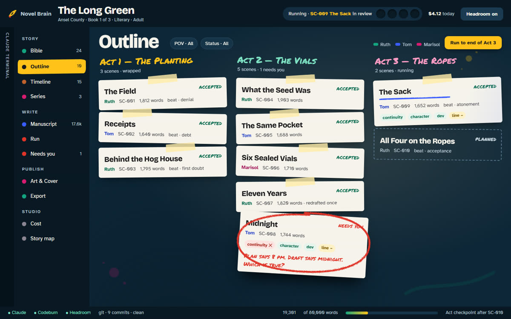

<div align="center">


<p>
<b>Early development.</b> Plans 1, 2 and 3 of 7 are done. Windows 11 only.<br>
An unofficial community project, not affiliated with or endorsed by Anthropic or Amazon.
</p>

</div>

> The manuscript is prose. Canon is truth. The outline is intent. Memory is evidence. Character state is the present. The Brain must never confuse them.

<h2>
<picture>
  <source media="(prefers-color-scheme: dark)" srcset="docs/assets/readme/h-what-it-is-dark.png">
  
</picture>
</h2>

Novel Brain is a Windows desktop app built to turn a writer's story design into a finished, consistent, publishable novel. Claude Code is the author. The app is the writers' room around it: it keeps the story's truth in plain files, lets Claude write only where it should, and keeps every change in git.

Today the app creates and opens book folders and installs a kit into each one: 12 Claude Code agents, 9 commands and 25 skills, 20 of them researched writing rules. Its run loop starts a fresh headless Claude session for each step. The session drafts a scene, proposes what it adds to canon, has six independent reviewers and a gate check it, and redrafts up to three rounds. A plain script then accepts the scene into the manuscript and canon with one git commit, or the scene is parked for the writer. Memory, the studio views, cover art and KDP export are planned, and the roadmap below says which plan brings each one.

<table>
<tr>
<td width="50%" valign="top">
<br>
<b>A guard on every write</b><br>
A hook stops Claude from writing canon, the accepted manuscript, run state or book settings, from leaving the book folder, and from running anything in the shell beyond read-only git and the acceptance script. Claude Code permission rules in the book deny the same paths a second time.
</td>
<td width="50%" valign="top">
<br>
<b>Files that must make sense</b><br>
A second hook checks each YAML or frontmatter file Claude writes, from scene plans to reviews and change requests, against its schema and tells Claude exactly what to fix.
</td>
</tr>
<tr>
<td width="50%" valign="top">
<br>
<b>One git repo per book</b><br>
A new book is its own git repository. Every accepted scene, approved author change, released scene, archive and kit upgrade is its own commit, so any of them can be traced or rolled back.
</td>
<td width="50%" valign="top">
<br>
<b>Researched writing skills</b><br>
Five audience profiles, eight genres, reader engagement, a prose check and five novel-craft skills (structure, scene, character, POV and dialogue, revision), each rule sourced.
</td>
</tr>
<tr>
<td width="50%" valign="top">
<br>
<b>Claude Code in the book</b><br>
The window runs Claude Code in a terminal whose working directory is the open book, and the run loop starts its headless sessions in the same folder, so Claude works in the book rather than in the app's code.
</td>
<td width="50%" valign="top">
<br>
<b>A setup wizard</b><br>
On first launch the app checks for the tools it needs and can install each one for you, using winget, npm, uv, or Claude Code's own installer and plugin commands.
</td>
</tr>
</table>

<h2>
<picture>
  <source media="(prefers-color-scheme: dark)" srcset="docs/assets/readme/h-how-it-works-dark.png">
  
</picture>
</h2>

**The founding rule.** Each kind of story material has its own place and its own authority. The outline is intent, so `outline/` holds plans. Canon is truth, so `canon/` holds facts, a timeline and who knows what. The manuscript is prose, so `manuscript/` holds accepted scenes. Claude can write plans, drafts, proposals and reviews freely. It can never write canon or the manuscript itself. Memory (Plan 4) will hold lessons about how to write, never story facts.

**An author and independent reviewers.** Each scene has an author agent and separate reviewers for continuity, character, development, line and audience, plus a canon auditor and a gate checker, each running as its own subagent and seeing only files. Nothing a producer writes is judged by the producer. A scene that still fails after three rounds is parked for the writer.

**Deterministic acceptance.** A scene reaches the manuscript only through `node .novelbrain/accept.mjs SC-###`, a plain bundled Node script with no model in it. It accepts only when all seven reviews are at the same round, none says FAIL, and none is older than the draft or a proposal. It then applies the scene's proposals to canon all or nothing, moves the draft into `manuscript/`, marks the plan accepted and makes exactly one git commit. On any failure it changes nothing.

**Git per book.** Creating a book runs `git init`, sets the repository's git identity to `Novel Brain <novelbrain@localhost>` if git has none configured, and commits everything as `Create <title>`. If any step fails, the half-made folder is removed.

**Two hooks, registered per machine.** When the app creates or opens a book it writes the hooks into the book's `.claude/settings.local.json`, which holds absolute paths on this machine and is git-ignored. Both hooks are bundled Node scripts in `resources/hooks/`.

**A second permission layer.** The kit's `.claude/settings.json` gives Claude Code its own allow and deny rules, so even with the hooks missing, Claude Code refuses edits to the protected paths.

<details>
<summary><b>The guard's rules</b> (PreToolUse, blocks with exit code 2)</summary>
<br>

Matcher: `Write|Edit|MultiEdit|NotebookEdit|Bash|PowerShell|mcp__.*`. It blocks:

- writes outside the book, and to `canon/`, `manuscript/`, `run/`, `book.yaml`, `series.yaml`, `.claude/`, `.novelbrain/` and `.git/`, to `.mcp.json`, `.gitignore`, `package.json` and root scripts, and to `CLAUDE.md`, `CLAUDE.local.md` and `.gitattributes` at any depth;
- suspicious Windows names: a trailing dot or space, `:`, and device names such as `CON` or `NUL`;
- every write in an archived book, and every write when `book.yaml` cannot be read;
- every MCP tool;
- every Bash and PowerShell command except `git diff`, `git log` and `git show` with a fixed list of read-only flags and plain path or revision arguments, and `node .novelbrain/accept.mjs SC-###`;
- any write with no file path, and anything it cannot decide (it fails closed).

Paths are resolved through symlinks and junctions before the check, so a link cannot smuggle a write out of the book. Source: `src/hooks/guard.ts` and `src/shared/bookpath.ts`.

</details>

<details>
<summary><b>The permission rules</b> (<code>.claude/settings.json</code>, from <code>kit/fiction/settings.json</code>)</summary>
<br>

- Allow: `Read`, `Glob`, `Grep`, `Edit`, `Write`, `Agent`, `Skill`, `Bash(node .novelbrain/accept.mjs *)`, `Bash(git diff *)`, `Bash(git log *)` and `Bash(git show *)`.
- Deny: `Edit(...)` on `/canon/**`, `/manuscript/**`, `/run/**`, `/book.yaml`, `/series.yaml`, `/.claude/**`, `/.novelbrain/**` and `/.git/**`. Claude Code consults `Edit` path rules for every built-in file-editing tool, and a deny holds in every permission mode.

Headless runs pass `--permission-mode acceptEdits` and the book's `.claude/settings.local.json` explicitly, and never `--bare`, which would skip the hooks and the kit.

</details>

<details>
<summary><b>The validator's rules</b> (PostToolUse on Write, Edit and MultiEdit)</summary>
<br>

After Claude writes one of these files, the hook checks it against the Zod schemas in `src/shared/schemas.ts`. On a mismatch it exits with code 2, which does not undo the write but shows Claude the exact problem so it can fix the file.

| File | Checked as |
|---|---|
| `book.yaml`, `series.yaml` | book and series settings |
| `outline/outline.yaml` | acts, chapters and ordered scene ids |
| `outline/scenes/SC-###.yaml` | a scene plan: goal, POV, location, story time, beats, arc beats, facts to reveal, status |
| `canon/facts.yaml`, `timeline.yaml`, `knowledge.yaml` | facts with `supersedes`, timeline events, who learned what and where |
| `proposals/P-####.yaml` | proposed `add`, `update` or `retcon` changes, each citing its scene |
| `reviews/<SC, CH or ACT id>/*.md` | the review frontmatter: target, reviewer, round, verdict, scenes to revise; `park.md` as a park note |
| `notes/open-questions.yaml` | questions the story has raised, where each must be answered and where it was |
| `notes/changes/CHG-####.yaml` | an author change request |
| `bible/characters/CHAR-*.md`, `bible/places/LOC-*.md` | the frontmatter block |

When a book is opened, the app also checks the whole folder: every schema, ids that match file names, duplicate facts, and cross-references (a scene's POV character and location must exist in the bible, facts it must reveal must exist in canon). Problems appear as a list at the top of the window, and a run will not start while any remain. Source: `src/main/book/validate.ts`.

</details>

<h2>
<picture>
  <source media="(prefers-color-scheme: dark)" srcset="docs/assets/readme/h-writing-loop-dark.png">
  
</picture>
</h2>

**The kit.** Every book gets the kit from `kit/fiction/`: its agents in `.claude/agents/`, its commands in `.claude/commands/`, its skills in `.claude/skills/`, the permission rules, a short `CLAUDE.md`, and the acceptance script in `.novelbrain/accept.mjs`. The `showrunner` skill is the orchestrator: it runs one step in the main session, dispatches the agents (none of them can dispatch another), reads only plans, verdict lines and findings so its context stays small, and ends with one line of JSON the app reads.

<details>
<summary><b>The 12 agents</b> (<code>kit/fiction/agents/</code>)</summary>
<br>

| Agent | Model | Job |
|---|---|---|
| `story-architect` | opus | Writes and revises the bible, the outline and scene plans |
| `author` | opus | Drafts a scene from its plan, and redrafts it from findings |
| `canon-keeper` | sonnet | Proposes the facts, timeline events and character knowledge a draft establishes |
| `canon-auditor` | haiku | Extracts the scene's canon changes blind and diffs them against the proposal |
| `continuity-reviewer` | sonnet | Checks a scene against canon; sweeps a whole act at act and book checks |
| `character-reviewer` | sonnet | Voice, motivation, arc, and that the POV character acts only on what they know |
| `developmental-editor` | sonnet | Story function of a scene, a chapter's new plans, or a whole act |
| `line-editor` | sonnet | Sentence-level prose against the style guide and the prose check |
| `audience-reviewer` | sonnet | Length, language, content limits and engagement for the book's audience |
| `gate-checker` | opus | Checks that each stage's files exist, parse and meet their requirements |
| `arc-auditor` | sonnet | After a chapter: are the planned arc beats on the page |
| `flow-reader` | sonnet | After a chapter: reads it end to end for transitions, pacing and engagement |

In the run loop the showrunner session runs on opus. The author and story architect have Read, Glob, Grep, Write and Edit; every other agent has Read, Glob, Grep and Write. `npm run test:kit` lints every agent and command.

</details>

<details>
<summary><b>The 9 commands</b> (<code>kit/fiction/commands/</code>)</summary>
<br>

| Command | What it runs |
|---|---|
| `/write-scene SC-###` | The scene loop: draft, proposal, seven reviews, up to three rounds, then acceptance or parking |
| `/revise-scene SC-### <review file>` | Revises an accepted scene from a chapter or act review's findings, then reviews and accepts it again |
| `/review-scene SC-###` | Only the six reviews and the gate, with no redraft and no acceptance |
| `/plan-chapter CH-##` | The story architect plans a chapter's scenes; the gate and the developmental editor check them |
| `/check-chapter CH-##` | The arc auditor and flow reader, then the gate |
| `/check-act ACT-#` | The developmental editor and a continuity sweep of the act, then the gate |
| `/check-book [focus]` | One continuity sweep per act against all of canon |
| `/new-character <description>` | Adds one character to the bible without changing any plan |
| `/propose-change <what>` | Writes an author change request for the writer to approve in the app |

The run loop sends `/write-scene`, `/revise-scene`, `/check-chapter` and `/check-act`. The writer can type any of them in the terminal.

</details>

**The scene loop.** A round is one draft by the author, one canon proposal by the canon-keeper, an early gate on both (up to two fixes), the six reviewers in parallel, and a final gate, which writes the seventh review. FLAG findings are notes for the writer; any FAIL fails the round, and the next round redrafts with every review of the last one as findings. When only the canon auditor fails, and only over the proposal, the canon-keeper rewrites the proposal and all seven reviews run again. A run gets at most three rounds per scene. After the last failed round the showrunner writes `reviews/SC-###/park.md` with the blocking findings by reviewer and rule id, and sets the plan to `needs-you`. A content-limit FAIL that survives the last round is always parked for the writer; the showrunner never changes the plan to get around it.

<details>
<summary><b>What acceptance checks and how it recovers</b> (<code>src/accept/</code>)</summary>
<br>

`accept.mjs SC-###` prints one line of JSON, `{"ok":true,"commit":"<hash>"}` or `{"ok":false,"reasons":[...]}`, and refuses when:

- the book is not active, `book.yaml` is not valid, or the repository has no git identity;
- the plan is missing or not valid, or the draft is missing, empty, not UTF-8 or contains a NUL byte;
- any of the seven reviews (`continuity`, `character`, `developmental`, `line`, `audience`, `canon-auditor`, `gate`) is missing, not valid, for another scene, signed by another reviewer, at an older round than the others, or FAIL;
- the reviews are older than the draft or one of the scene's proposals (they must have read the current files);
- `proposals/` holds anything other than `P-####.yaml` files, or one of this scene's proposals is not valid;
- the proposals do not apply: facts are only added or retconned (a retcon is a new fact that supersedes an established one, which becomes `superseded`), timeline events need a known place and known characters, and knowledge needs a known character and an existing fact;
- a folder on the way to a file it writes is a symlink or junction.

It then writes canon, the manuscript and the plan's `status: accepted`, deletes the draft and the scene's proposals, checks canon, the manuscript and the plan again, and commits exactly those paths by name (`git add -f -A -- <paths>`: the `-A` is limited to the listed paths, so it also stages their deletions, never a whole-tree add) as `Accept SC-###: <title>`.

**Journal and lock.** Before it reads the scene's files it creates `.novelbrain/accept.journal` exclusively, which is the lock. Before it writes, the journal holds a snapshot of every file it will touch, the process id, the start time, the current HEAD and a random nonce, and the commit carries that nonce as a `Novel-Brain-Accept: <nonce>` trailer. On a failure it restores the snapshot, file times included. If a run was killed, the next acceptance finds the journal: it refuses while that process is alive and the journal is under 10 minutes old, discards the journal when a commit with its nonce has landed, and otherwise restores the snapshot (only paths acceptance or an author change may write) before going on. Approving an author change uses the same lock and journal.

</details>

**Chapter and act checks.** When every scene of a chapter is accepted, the run sends `/check-chapter`; when every chapter of an act is checked, `/check-act`. A check that fails names the scenes to revise, and the run sends `/revise-scene` for each, then checks that chapter and act again. A chapter or act that asks for revisions a second time in the same app session stops the run for the writer.

**Stop points.** **Start** takes a stop point: `scene` stops before the next scene once one scene has been accepted, `chapter` stops after the first chapter check that passes, `act` stops after the first act check that passes, and `book` runs on. **Pause at act checkpoints** (on by default, kept in `run/state.yaml` as `pauseAtActs`) also stops the run after every act check (status `checkpoint`) for the writer to read the act, whatever the stop point; with it off, `book` writes straight through. The run ends `done` when the last act passes. Memory distilling and learned-skill approvals at act checkpoints are Plan 4.

**What else stops a run.** A parked scene (`needs-you`), an empty outline, a step that fails twice in a row (`error`), **Pause** (which kills the running step), and a Claude plan usage limit (`usage-limit`, with the reset time shown). Pressing **Start** again picks up from the files, so accepted scenes are never redone. There is no cost cap: the app adds each step's reported cost to a running total for the book and shows it as **Spent so far**.

<details>
<summary><b>What the runner does not take on trust</b> (<code>src/main/run/</code>)</summary>
<br>

- Each step is a new `claude -p` session with `--output-format json`, the command as its prompt, and a 45-minute timeout. The step must end with its JSON result line for the same id, or it failed.
- A scene counts as accepted only when `manuscript/SC-###.md` exists and an `Accept SC-###:` commit landed during the step; Claude can write neither. A step that claims acceptance without both stops the run for the writer. A plan that says `accepted` with no manuscript file is treated as planned.
- Acceptance is final: if a step fails after its acceptance commit landed, the scene stays accepted and is not run again.
- A step that says it parked a scene must have left the plan at `needs-you`.
- From a check's revise list, only scenes of that chapter or act are queued, and only a `reviews/CH-##/` or `reviews/ACT-#/` file is passed on as findings.
- After every step the app commits what Claude may write (`bible/`, `outline/`, `notes/`, `reviews/`, `drafts/`, `proposals/`) by explicit path as `Step <id> working files`.
- A failed step's cost still counts when the output reported it. A `run/state.yaml` that cannot be read is kept as `run/state.yaml.bad` and the run starts from defaults with the spending total kept. A state left `running` by a closed app reads as `paused`.

</details>

**Releasing a parked scene.** The run bar lists parked scenes with the reason from `park.md`. **Release** (with the run stopped) sets the plan back to `planned` and commits `Release SC-### to planned`; the next run's first round gives the author the park reason as findings.

**Author changes.** To change canon or the manuscript directly, the writer asks Claude in the terminal, or types `/propose-change <what>`. Claude writes `notes/changes/CHG-####.yaml`: canon changes (add, or a retcon; facts are never edited), a whole new text for a scene in the outline, or a scene reopened to `planned`. The app lists it under **Changes waiting for you**. **Preview** shows each file before and after, and **Approve** applies exactly what was previewed: it carries a token (a SHA-256 of the change file and every file it touches) and is refused if anything changed since. Approval is refused while a run is going, in an archived book, and when the book check finds a problem the change would add. It commits only the touched files as `Author change CHG-####: <summary>` and moves the request to `notes/changes/applied/`; **Reject** moves it to `notes/changes/rejected/` in its own commit.

<h2>
<picture>
  <source media="(prefers-color-scheme: dark)" srcset="docs/assets/readme/h-book-folder-dark.png">
  
</picture>
</h2>

A book is plain Markdown and YAML with stable ids (`SC-014`, `CHAR-RUTH`, `LOC-FIELD`, `FACT-005`), so reordering the outline never renames a file. This is what **New book** creates (`src/main/book/create.ts`, `src/main/book/kit.ts`):

```text
my-book/
  book.yaml            id, title, status (active|archived), audience, genres,
                       series, predecessor, wordTarget, kitVersion ("3")
  CLAUDE.md            short rules for Claude in this book (from the kit)
  .gitignore           exports/, run/, .claude/settings.local.json
  .claude/
    agents/            the 12 kit agents
    commands/          the 9 kit commands
    skills/            the 25 kit skills
    settings.json      the permission rules
    settings.local.json  the guard and validate hooks (machine-specific)
  .novelbrain/
    accept.mjs         the acceptance script
    kit-manifest.json  the files the kit installed
  bible/
    characters/  places/  world/
  outline/
    outline.yaml       starts as { acts: [] }
    scenes/
  canon/
    facts.yaml  timeline.yaml  knowledge.yaml   (start empty)
  manuscript/  drafts/  proposals/  reviews/  notes/  art/
  .git/                one commit: "Create <title>"
```

Created later: `run/state.yaml` (git-ignored) by the first run, `notes/open-questions.yaml` and `notes/changes/` by Claude, and the git-ignored `exports/` (Plan 7).

**Kit upgrade.** Opening an active book whose `kitVersion` is not the app's (3) reinstalls the kit (agents, commands, skills, permission rules, `CLAUDE.md` and `accept.mjs`), removes files an earlier kit installed that the new one no longer has, sets `kitVersion`, and commits `Update kit to v3`. Files the kit did not install are left alone. Archived books keep their kit.

**Archive and sequel.** Archiving sets `status: archived` in one commit, after stopping any run; the guard then blocks every write by Claude, and there is no un-archive. A sequel needs an archived predecessor. It is a new book in the folder beside it, with `predecessor:` and `series:` set, a copy of the predecessor's `bible/` characters, places and world, and a `notes/predecessor.md` saying the earlier book's `canon/` is read-only reference. It copies no canon, manuscript, drafts, notes, reviews or run state. Both exist in the app's main process today; their buttons arrive with the studio UI (Plan 5).

A series is planned as one git repo holding `series.yaml`, a shared `bible/` and `canon/`, and `books/<book>/`, with series promotion in Plan 5. The series schema and the guard's protection of `series.yaml` exist.

<h2>
<picture>
  <source media="(prefers-color-scheme: dark)" srcset="docs/assets/readme/h-research-dark.png">
  
</picture>
</h2>

The rules the writing agents follow were researched first, from publisher and agent guidelines, editorial references, craft books and teachers, reading research and librarian guidance. Every rule names its sources, and every reader-psychology rule ends with a `Check:` line a reviewer can answer pass or fail from the text alone. Judgments no source states are labelled as house settings or editorial judgment. Each skill lists its sources at the end.

<details>
<summary><b>The 20 researched skills in <code>kit/fiction/skills/</code></b></summary>
<br>

| Kind | Skills |
|---|---|
| Audience profiles (5) | `audience-early-chapter` (about 6 to 9), `audience-middle-grade` (about 8 to 12), `audience-young-adult` (about 12 to 18), `audience-new-adult` (about 18 to 25), `audience-adult` |
| Reader engagement (1) | `reader-engagement`: curiosity, suspense, identification, transportation, payoff and variety, for every book |
| Genres (8) | `genre-literary`, `genre-mystery`, `genre-thriller`, `genre-romance`, `genre-fantasy`, `genre-science-fiction`, `genre-horror`, `genre-historical` |
| Prose check (1) | `writing-sucks`: an advisory prose pass adapted from Kieran Drew's SUCKS checklist |
| Novel craft (5) | `craft-structure`, `craft-scene`, `craft-character`, `craft-pov-dialogue`, `craft-revision`, each citation-audited |

Five more skills tell the agents how this book works rather than how to write: `showrunner`, `book-rules` (who writes where, and how to ask for an author change), `scene-context` (which files to read for one scene), `proposal-format` and `style`.

`book.yaml` names one audience and one or more genres; the book's `CLAUDE.md` and the agents read those skills from `.claude/skills/` before writing or judging prose, and each agent preloads the craft and engagement skills its job needs. `npm run test:kit` checks every skill's structure, rule ids and source lines.

</details>

<h2>
<picture>
  <source media="(prefers-color-scheme: dark)" srcset="docs/assets/readme/h-today-dark.png">
  
</picture>
</h2>

The current window is deliberately plain. A bar across the top shows the logo, the open book's title (with an Archived badge when it applies), **Open book…** and **New book…**. New book asks for a title, an audience and one genre, sets an 80,000-word target, and lets you pick the parent folder. Below the bar, any problems the validator found are listed.

The run bar has a **Stop at** choice (scene, chapter, act or book; act by default), **Start** and **Pause**, and a status line with the current step, **Spent so far**, the reset time after a usage limit, and the last error. Parked scenes are listed with their reason and a **Release** button. When Claude has written an author change, **Changes waiting for you** lists it with **Preview**, **Approve** and **Reject**. The rest of the window is a terminal running Claude Code in the book folder. The File menu has **Open Book…** (Ctrl+Shift+O) and the Tools menu has **Re-run setup**.

The setup wizard checks Git, Node.js 22.13 or later, Claude Code and Codeburn (required), plus uv, Headroom, Graphify and Ponytail (optional). Each step can be installed from the wizard, and optional ones can be skipped. Codeburn then runs as a local background service. Headroom does too when it is installed and its setting is on (the default), and Claude Code's traffic, from the terminal and from the run loop, then goes through its local proxy.

<div align="center">

<p><i>Design direction for the studio UI (Plan 5). Not the current interface.</i></p>
</div>

<h2>
<picture>
  <source media="(prefers-color-scheme: dark)" srcset="docs/assets/readme/h-run-dark.png">
  
</picture>
</h2>

You need Windows 11, Node.js 22.13 or later, Git, and Claude Code installed and signed in to your Claude plan.

```sh
npm install
node node_modules/electron/install.js
npm run dev
```

The second line runs Electron's own installer, which downloads the Electron binary if `npm install` skipped it. On first launch the setup wizard checks the remaining tools.

<h2>
<picture>
  <source media="(prefers-color-scheme: dark)" srcset="docs/assets/readme/h-development-dark.png">
  
</picture>
</h2>

| Command | What it does |
|---|---|
| `npm run dev` | Start the app with hot reload (`electron-vite dev`) |
| `npm run build` | Build the main, preload and renderer bundles (`electron-vite build`) |
| `npm run typecheck` | Type-check with `tsc --noEmit` |
| `npm test` | Run the Vitest unit tests in `test/` |
| `npm run test:kit` | Check the kit: every skill's rules and sources, and every agent and command |
| `npm run smoke` | Build the hooks and the app, then run the Playwright tests with a fake Claude: a book opens with the guard registered and leaves no processes after quit; a one-act book runs to done; a failing scene parks, shows its reason and is released; an author change is previewed and approved |
| `npm run build:hooks` | Bundle the guard, the validator and `src/accept/accept.ts` into `resources/hooks/` and `resources/accept/` |
| `npm run dist` | Build the hooks and the app, then a Windows NSIS installer in `dist/` (not code-signed, not published) |
| `npm run release` | The same as `dist`, then publish with electron-builder (`--publish always`) |

`node scripts/render-readme-art.mjs` re-renders this README's images from `docs/assets/readme/*.html` with headless Chrome.

The unit tests cover the guard (paths outside the book, protected paths, `..`, symlinks and junctions, Windows name tricks, archived books, the shell allowlist), the validator and schemas, canon application and retcons, acceptance (missing, stale and failing reviews, rollback, the journal, recovery after a kill), the run planner and runner (stop points, parking, revisions, usage limits, forged acceptance), author changes, the kit install and upgrade, archive and sequel, book creation, settings and the setup wizard.

<h2>
<picture>
  <source media="(prefers-color-scheme: dark)" srcset="docs/assets/readme/h-roadmap-dark.png">
  
</picture>
</h2>

| Plan | What it brings | Status |
|---|---|---|
| 1. Research | Audience, reader-psychology and genre research; the first 15 kit skills | Done |
| 2. Foundation | Electron shell, setup wizard, book format and schemas, guard and validate hooks, new and open book, git per book | Done |
| 3. Kit and run loop | 12 agents, 9 commands, the showrunner and five craft skills; `accept.mjs`; the headless scene, chapter and act loop with stop points, parking and act checkpoints; author changes approved in the app; archive, sequel and kit upgrade | Done |
| 4. Memory | Writer, series and book memory with automatic distilling; distilling and skill approvals at act checkpoints | Planned |
| 5. Studio UI | The studio views: bible, outline, timeline, manuscript, run, needs you, cost; the series view and series promotion | Planned |
| 6. Art and cover | Painted wraparound covers and interior art, every paid draw behind a click | Planned |
| 7. Export and release | KDP print interior PDF, cover PDF and EPUB with preflight; installer releases; a Claude Code version check | Planned |

GitHub Actions runs every test suite on Windows for each push, and a `v*` tag builds the Windows installer and attaches it to a GitHub release.

<h2>
<picture>
  <source media="(prefers-color-scheme: dark)" srcset="docs/assets/readme/h-credits-dark.png">
  
</picture>
</h2>

- **ClaudeCodeMax**, by the same owner: the app shell (the Claude Code terminal, service manager, setup wizard, security and settings) was seeded from it.
- **Imagineer**, by the same owner: the headless Claude runner and its usage-limit detection were adapted from it, and its cover, art and KDP code is planned to come over in Plans 6 and 7.
- **Kieran Drew's SUCKS checklist**: adapted for fiction as the `writing-sucks` skill. SUCKS is a copywriting framework; the fiction rules are house adaptations, described in `kit/fiction/skills/writing-sucks/SKILL.md`.
- **Craft writers and teachers** cited in the five craft skills: each rule names its sources, listed at the end of its skill.
- **Libraries**: Electron, React, xterm.js, node-pty (`@lydell/node-pty`), Zod and yaml in the app; electron-vite, Vite, TypeScript, esbuild, Vitest, Playwright and electron-builder for building and testing.
- **Tools the setup wizard installs** are separate projects with their own licenses: Git, Node.js, Claude Code, Codeburn, uv, Headroom, Graphify and Ponytail.
- **README art** is set in Bricolage Grotesque and Permanent Marker from Google Fonts.

**License.** [MIT](LICENSE). Anyone may use, copy, change and share Novel Brain, including commercially, as long as the copyright notice and license text stay with it.

**Disclaimer.** Novel Brain is an unofficial community project. It is not affiliated with, endorsed by or sponsored by Anthropic or Amazon. Claude and Claude Code are Anthropic products; Kindle Direct Publishing is an Amazon service.
